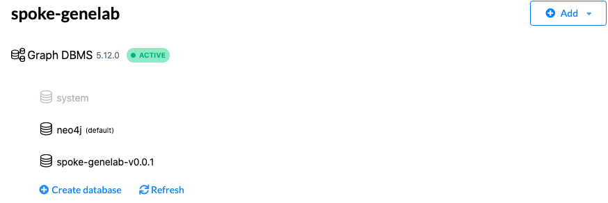
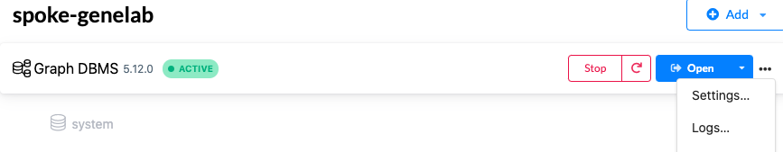
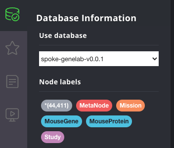

## ⚙️ Create spoke-genelab Knowledge Graph 

**Needs to be updated for new Neo4j Desktop Version**

### Setup the Environment

Prerequisites: Miniconda3 (light-weight, preferred) or Anaconda3 and Mamba (faster than Conda)

* Install [Miniconda3](https://docs.conda.io/en/latest/miniconda.html)
* Update an existing miniconda3 installation: ```conda update conda```
* Install Mamba: ```conda install mamba -n base -c conda-forge```
* Install Git (if not installed): ```conda install git -n base -c anaconda```
------

1. Clone this Repository

```
git clone https://github.com/BaranziniLab/spoke_genelab.git
cd spoke_genelab
```

2. Create a Conda environment

The file `environment.yml` specifies the Python version and all required dependencies.

```
mamba env create -f environment.yml
```

3. Create an account in [BioPortal](https://bioportal.bioontology.org/) and copy the API key. BioPortal is used to map terms to ontologies.

   
4. Copy the file `env_template` to `.env`

5. Edit the file `.env` and set the following variables

KG version number

`KG_VERSION=v0.3.1`

Path to the cloned git repository

`KG_GIT=/Users/.../spoke_genelab/`

Path to the Neo4j instance in Neo4j Desktop. Make sure to enclose the path in quotes.

`NEO4J_INSTALL_PATH="/Users/.../Library/Application Support/Neo4j Desktop/Application/relate-data/dbmss/dbms-3d4b95d1-0219-480b-a3c4-ee5a409cc383"`

BioPortal API Key

`BIOPORTAL_API_KEY=<bioportal api key>`

------

### Download and Process Datasets and upload to Neo4J Graph Database

1. Start the spoke-genelab Graph DBMS


2. Activate the conda environment

```
conda activate spoke-genelab
```

3. Launch Jupyter Lab

```
jupyter lab
```

4. Navigate to the `notebooks` directory and run the following notebooks

| Notebook                   |   Description           |
|----------------------------|-------------------------|
| 1_download_datasets.ipynb  | Downloads datasets     |
| 2_create_study_mission_nodes.ipynb | Creates Study and Mission nodes and their relationships |
| 3_create_gene_nodes.ipynb  | Creates MGene (model organism) and mapped Gene (human) gene nodes |
| 4_create_assay_nodes.ipynb | Creates Assay nodes and their relationships |
| 5_import_to_neo4j.ipynb    | Imports the formatted data into a Neo4j KG |
| 6_query_examples.ipynb     | Runs example queries (optional) |

5. When the import is completed, click the `Refresh` button in Neo4j Desktop. The newly created database `spoke-genelab-v0.3.1` will be listed.



6. Click the `Open` button to launch the database.



7. Click on the database icon on the left.


8. Use the pull-down menu to select a version of `spoke-genelab-v0.3.1` database. Wait for about 30+ seconds until the database is loaded and the nodes are listed as shown below.
   


9. Set the Graph Stylesheet

Drag the file kg/v0.3.1/style.grass onto the Neo4j Browser window to set the node colors, sizes, and labels.

10. Now you are ready to run Cypher queries on the selected database.

11. When you are finished, stop the database in the Neo4j Desktop.

To stop the conda environment, type

```conda deactivate```

------

### Dump Neo4J Graph Database
1. Stop the database

2. Hover the cursor over the `spoke-genelab-v0.3.1` database and select `Dump` from the menu.


3. When the dump is complete, click the `Reveal files in Finder` button to open the directory that contains the `spoke-genelab-v0.3.1.dump` file.


This database dump will be used to create the SPOKE-GeneLab composite database.
